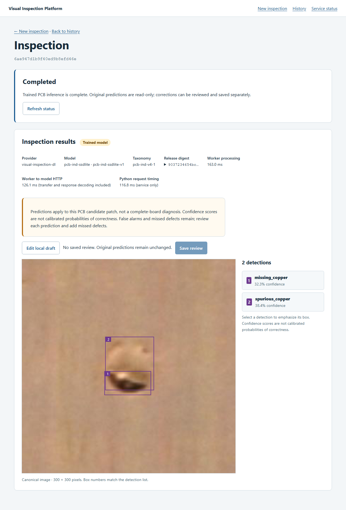
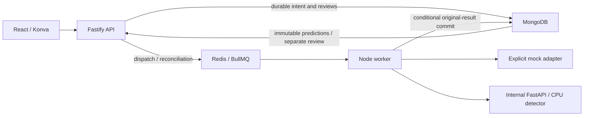

# Visual Inspection Platform — Real PCB Inference Integration

[](https://github.com/ThePhysic/visual-inspection-platform-pcb/actions/workflows/ci.yml?query=branch%3Aintegration%2Freal-pcb)

**A released PyTorch PCB detector, a private FastAPI service, a recoverable
BullMQ/Redis worker, and MongoDB-backed human review.** Upload a candidate patch,
inspect real predictions, correct all eight defect classes, and reopen the saved
review while the original model result stays immutable.

| Explicit inspection mode | What runs |
| --- | --- |
| **Simulated demo** — default | Deterministic mock predictions and two-class review; five services, no DL checkout or model download |
| **Trained PCB detector** — opt in | Pinned CPU model through the Node worker; an additional internal Python service and eight-class review |

Trained mode requires an identified **300×300 PCB candidate patch** and explicit
user attestation. It does not search whole boards. Scores are uncalibrated; false
alarms and missed defects remain. Model outages cause bounded retries or failure,
with **no simulated substitution**. This is a local portfolio demonstration,
unaffiliated with Matroid and not validated for production manufacturing inspection.



[Saved eight-class review](docs/real-inference/trained-review.png) ·
[Mode selection and upload](docs/real-inference/trained-upload.png) ·
[History and reopening](docs/real-inference/trained-history.png) ·
[Two-to-three-minute demo scripts](docs/demo.md)

These are unmodified browser captures from the real CPU stack. The pictured
PCB-IND v4 image is a **training-set serving fixture**, not holdout quality
evidence. Human edits demonstrate review operations, not expert ground truth.
Image: Hao Yan, Fujian Polytechnic Normal University, CC BY 4.0;
[source, hashes and split provenance](fixtures/pcb/README.md).

## Quick start — simulated demo, Docker only

Prerequisites: Git and Docker Desktop using Linux containers, or Docker Engine
with Compose **2.20+** and BuildKit. Initial builds require registry access.
No host Node.js, pnpm, credentials, `.env`, or DL clone is required.

```powershell
git clone https://github.com/ThePhysic/visual-inspection-platform-pcb.git visual-inspection-platform
cd visual-inspection-platform
docker compose -p vip-demo up -d --build --wait --wait-timeout 120
```

Open **http://127.0.0.1:8080**. Keep **Simulated demo** selected, upload
[`fixtures/inspections/machined-panel.png`](fixtures/inspections/machined-panel.png),
choose **Upload and inspect**, then **Edit local draft** and **Save review**.
The original illustrated panel has deliberately wrong, extra and missing mock
regions to demonstrate corrections. Use `clean-panel.png` for zero detections or
`edge-component.png` for portrait geometry.
[Mock fixture provenance](fixtures/inspections/README.md) ·
[Mock result](docs/screenshots/inspection.png) ·
[Saved mock review](docs/screenshots/review.png).

```powershell
docker compose -p vip-demo ps
docker compose -p vip-demo logs --tail 100 api worker
docker compose -p vip-demo down
```

Only the web port is published, on loopback. Start again with the same project
name to reuse images, inspections and reviews. **Do not add `--volumes` to routine
shutdown: it deletes stored data.** For port conflicts, set `WEB_PORT` in an
optional `.env`, or `$env:WEB_PORT = '18080'` in PowerShell.
[Container setup and troubleshooting](docs/containers.md) ·
[MongoDB/kernel compatibility](docs/ci-mongodb-compatibility.md).

## Optional real PCB inference

The [real-mode guide](docs/real-pcb-inference.md) explains the public sibling-clone
setup, strict release verification, alternative paths, attribution and recovery.
From the simulated quick-start checkout, stop that stack before reusing port 8080.
The preflight command below requires **Node 24.22.0**; model execution uses Docker
and requires no GPU or cloud credentials.

```powershell
docker compose -p vip-demo down
cd ..
git clone https://github.com/ThePhysic/visual-inspection-dl.git visual-inspection-dl
git -C visual-inspection-dl checkout --detach 399a8da7407689a0ffd7dc9bde074600dd8dcbcc
cd visual-inspection-platform
node infra/real/verify-release.mjs
docker compose -p vip-pcb -f compose.yaml -f compose.real.yaml up -d --build --wait --wait-timeout 180
```

Open **http://127.0.0.1:8080**, press **Check trained model availability**, explicitly
choose **Trained PCB detector**, and select a JPEG from `fixtures/pcb`. Confirm
that it is a real 300×300 PCB candidate patch. The result shows release
`pcb-ind-ssdlite-v1`, taxonomy `pcb-ind-v4-1`, and its immutable artifact digest.
Reject, relabel or move predictions; add a missed defect; save, refresh and reopen
the review from history. A new upload defaults to simulated mode.

```powershell
docker compose -p vip-pcb -f compose.yaml -f compose.real.yaml down
```

## Application and model boundary



This repository owns upload validation, durable jobs, image storage, HTTP response
validation, review conflicts, history and the UI. The independently runnable
[DL repository](https://github.com/ThePhysic/visual-inspection-dl) owns training,
evaluation, the versioned bundle and FastAPI serving. No model source or weights
are copied here. The browser never calls Python; only the worker predicts, and
the inference port is not published to the host.

MongoDB owns durable intent; Redis schedules it. Generation-specific work,
three-attempt budgets, expiring leases and conditional commits protect results
under retries and worker failure. Review saves use revision checks and operation
receipts without changing original predictions.
[Architecture](docs/architecture.md) · [Pipeline guarantees](docs/inspection-pipeline.md) ·
[Review contracts](docs/reviews.md) · [Original SWE project](https://github.com/ThePhysic/visual-inspection-platform).

## Evidence and verification

Recorded integrated CPU measurements on a Ryzen 9 7940HS / Windows Docker Desktop,
concurrency one; nearest-rank percentiles:

| Observed boundary | Samples | p50 / p95 |
| --- | ---: | ---: |
| Full upload → API-observed trained completion, 100 ms polling | 30 | 155.08 / 274.80 ms |
| Upload click → browser-visible Completed heading, 2 s polling | 20 | 2429.97 / 2441.18 ms |

The browser samples repeat a training-set fixture; the API samples cycle four
attributed patches. These are separate workloads and observation boundaries,
not an SLA or an accuracy claim. See the [recorded acceptance and methodology](docs/real-inference/REPORT.md)
and [adversarial re-audit](docs/real-inference/REAUDIT.md). The historical 113 ms
**simulated** visibility result and DL forward-only timings are different
measurements; [mock pipeline optimization evidence](docs/performance.md) is retained.

**Automatic GitHub CI** runs lint, typecheck, unit/component tests and production
builds on Ubuntu and Windows; real MongoDB/API and Chromium suites; and isolated
container/browser/reliability checks. The badge above tracks this repository's
`integration/real-pcb` branch. It does not mean the full six-service trained-model
acceptance or its measurement workload runs on ordinary pushes.

The separate manual [Real model CPU smoke](.github/workflows/real-model-smoke.yml)
clones the exact public DL revision and checks trained readiness, one real worker
prediction, explicit mock identity and an eight-class review save/reopen. It runs
on demand, without repeating the measurement workload. See the
[current public-checkout verification](docs/presentation-verification.md).

**Recorded local real-model acceptance** separately proves trained inference,
eight-class review/save/reopen, typed busy and timeout recovery, outage exhaustion,
worker/Redis interruption and restart persistence. The v1.1 audit records 396
unit/component tests, 153 MongoDB/API integration tests, 20 Chromium tests and
eleven real-stack acceptance checks. Those records retain their tested revisions
and do not claim a new measurement from documentation changes.

With the pinned native tooling and Chromium installed:

```powershell
pnpm install --frozen-lockfile
pnpm lint
pnpm typecheck
pnpm test
pnpm build
pnpm --filter @vip/web exec playwright install chromium
pnpm test:ci:integration
pnpm test:reliability --browser
```

These scripts use owned disposable test resources. On affected Linux kernels add
`--ci-mongodb` to container reliability as documented in the
[compatibility guide](docs/ci-mongodb-compatibility.md). Real-model verification
commands are in the [real-mode guide](docs/real-pcb-inference.md).
[Security assessment and limitations](docs/security/README.md) ·
[Reliability evidence](docs/reliability.md) · [Operations and metrics](docs/observability.md).

## Native development

Use **Node 24.22.0** and **pnpm 10.34.7**; Docker runs the dependencies:

```powershell
pnpm install --frozen-lockfile
docker compose -p vip-native -f compose.yaml -f compose.dev.yaml up -d --wait mongodb redis
pnpm dev
```

Open **http://127.0.0.1:5173**. Native image storage in `.data/images` is separate
from container storage. See [.env.example](.env.example) and
[development/configuration](docs/development.md).

## Limits and terms

- Trusted single-user local use: no authentication, public TLS or internet hardening.
- Single-host storage, without a coordinated backup or high-availability guarantee.
- At-least-once execution can repeat inference; no exactly-once execution promise.
- Reviews retain the latest snapshot and bounded save receipts; unsaved drafts stay in memory.
- Trained inference is limited to identified 300×300 candidate patches; no full-board
  search, tiling, online learning or retraining from review edits.
- The model's 44.17% AP50 / 27.19% AP50:95 is the frozen 722-image ROI holdout
  study, not integrated-application accuracy or arbitrary-image validation.

No whole-repository license has been selected or redistribution grant implied.
PCB data attribution and pretrained-model terms remain distinct; see the
[fixture manifest](fixtures/pcb/README.md), the DL project's
[third-party terms](https://github.com/ThePhysic/visual-inspection-dl/blob/399a8da7407689a0ffd7dc9bde074600dd8dcbcc/docs/THIRD_PARTY.md),
and [portfolio notes](docs/portfolio-summary.md). There is no hosted public application
or linked demo video; the [demo scripts and authentic screenshots](docs/demo.md)
show the reproducible workflow.
